

  
   
  
   
  

I'm Fathimath Malaak Jaufar. I design and build websites and small tools, mostly with HTML, CSS and JavaScript.

  
  
  
  
  

## GitHub Stats and Activity

  <table>
    <tr>
      <td width="50%">
        
      </td>
      <td width="50%">
        
      </td>
    </tr>
    <tr>
      <td width="50%">
        
      </td>
      <td width="50%">
        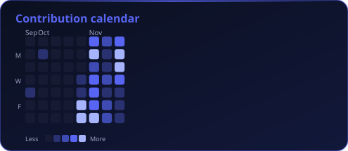
      </td>
    </tr>
  </table>
  
   
  

## Featured work

<table width="100%">
  <tr>
    <td width="50%" valign="top" align="center">
      <a href="https://reseachrandomv.github.io/solea-cafe/">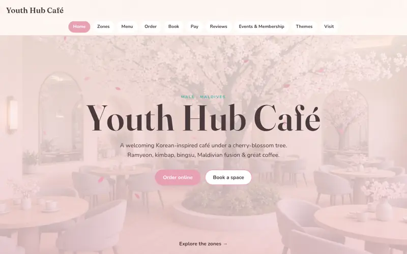</a>
      <h3>Youth Hub Café</h3>
      
A Korean-inspired café website concept, with five zones, a menu, and online order and booking flows.

      
<a href="https://reseachrandomv.github.io/solea-cafe/">Live site</a> · <a href="https://github.com/reseachrandomv/solea-cafe">Repo</a>

    </td>
    <td width="50%" valign="top" align="center">
      <a href="https://reseachrandomv.github.io/">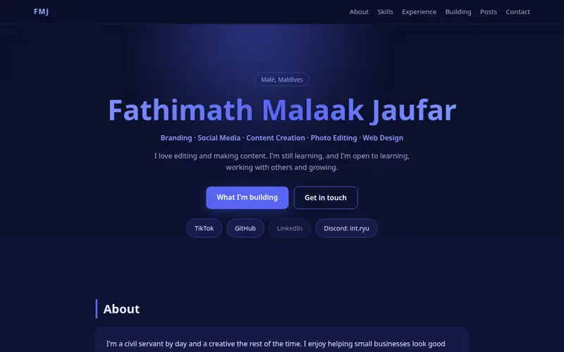</a>
      <h3>Portfolio</h3>
      
Personal site for branding, social media, content, photo editing and web design.

      
<a href="https://reseachrandomv.github.io/">Live site</a> · <a href="https://github.com/reseachrandomv/reseachrandomv.github.io">Repo</a>

    </td>
  </tr>
  <tr>
    <td width="50%" valign="top" align="center">
      <a href="https://reseachrandomv.github.io/cv/">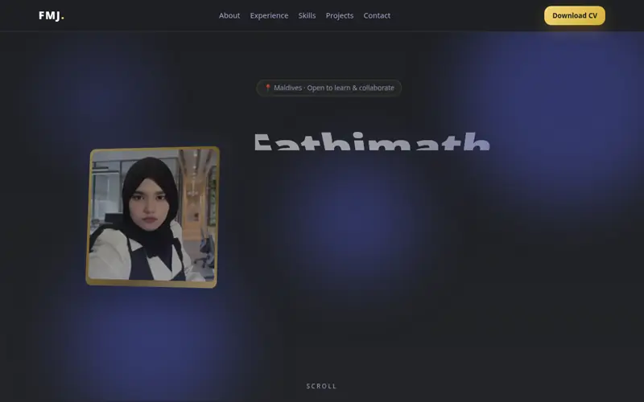</a>
      <h3>CV</h3>
      
Interactive CV, with a downloadable PDF.

      
<a href="https://reseachrandomv.github.io/cv/">Live site</a> · <a href="https://github.com/reseachrandomv/cv">Repo</a>

    </td>
    <td width="50%" valign="top" align="center">
      <a href="https://reseachrandomv.github.io/malaak-card/">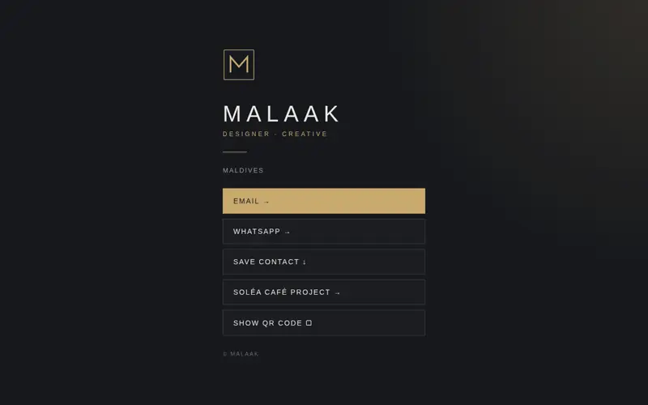</a>
      <h3>Digital card</h3>
      
Contact card with email, WhatsApp, a vCard download and a QR code.

      
<a href="https://reseachrandomv.github.io/malaak-card/">Live site</a> · <a href="https://github.com/reseachrandomv/malaak-card">Repo</a>

    </td>
  </tr>
</table>

## Tools

<table width="100%">
  <tr>
    <td width="50%" valign="top" align="center">
      
      <h3>Privacy Shield Studio</h3>
      
A client-side toolkit to strip image metadata, scrub secrets and PII, and clean tracking URLs in the browser.

      
<a href="https://reseachrandomv.github.io/privacy-shield-studio/">Live site</a> · <a href="https://github.com/reseachrandomv/privacy-shield-studio">Repo</a>

    </td>
    <td width="50%" valign="top" align="center">
      
      <h3>PromptArchitect</h3>
      
A visual studio for AI system prompts and agent skills, exported as Markdown, XML, JSON Schema or SKILL.md.

      
<a href="https://reseachrandomv.github.io/promptarchitect/">Live site</a> · <a href="https://github.com/reseachrandomv/promptarchitect">Repo</a>

    </td>
  </tr>
  <tr>
    <td width="50%" valign="top" align="center">
      <a href="https://github.com/reseachrandomv/hookbox">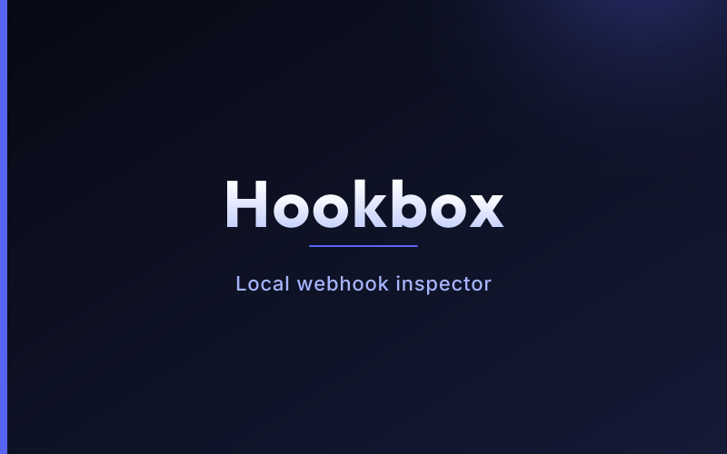</a>
      <h3>Hookbox</h3>
      
A local webhook inspector: catch, verify (Stripe and GitHub) and replay requests from one command.

      
<a href="https://github.com/reseachrandomv/hookbox">Repo</a>

    </td>
    <td width="50%"></td>
  </tr>
</table>

## Dhivehi & local

<table width="100%">
  <tr>
    <td width="50%" valign="top" align="center">
      <a href="https://reseachrandomv.github.io/liyun/">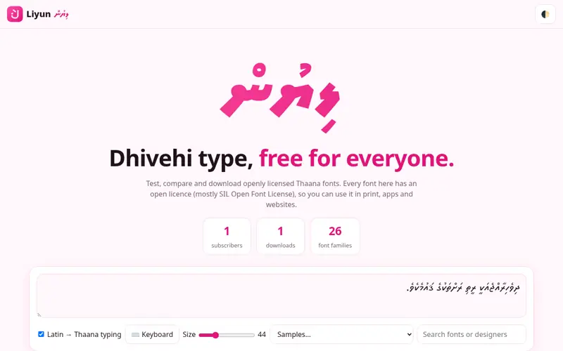</a>
      <h3>Liyun Dhivehi fonts</h3>
      
Free, openly licensed Thaana fonts, with a live type tester, a Latin-to-Thaana keyboard and web CSS snippets.

      
<a href="https://reseachrandomv.github.io/liyun/">Live site</a> · <a href="https://github.com/reseachrandomv/liyun">Repo</a>

    </td>
    <td width="50%" valign="top" align="center">
      <a href="https://reseachrandomv.github.io/raajje-digest/">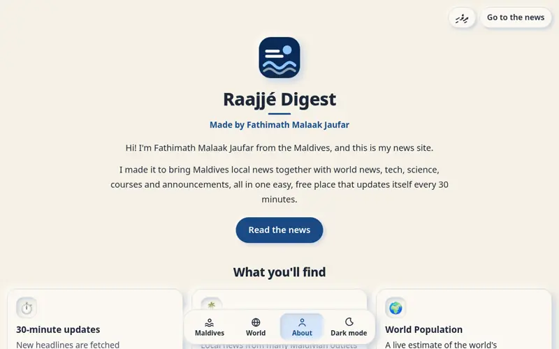</a>
      <h3>Raajjé Digest</h3>
      
A news site with local and world news, tech, science, courses and announcements, updated every 30 minutes.

      
<a href="https://reseachrandomv.github.io/raajje-digest/">Live site</a> · <a href="https://github.com/reseachrandomv/raajje-digest">Repo</a>

    </td>
  </tr>
</table>

## Connect

[Portfolio](https://reseachrandomv.github.io/) · [Digital card](https://reseachrandomv.github.io/malaak-card/)

