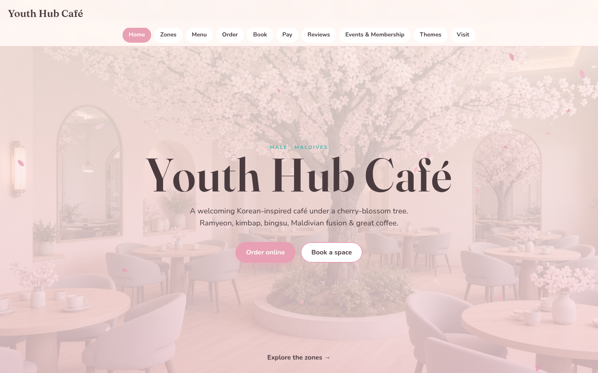
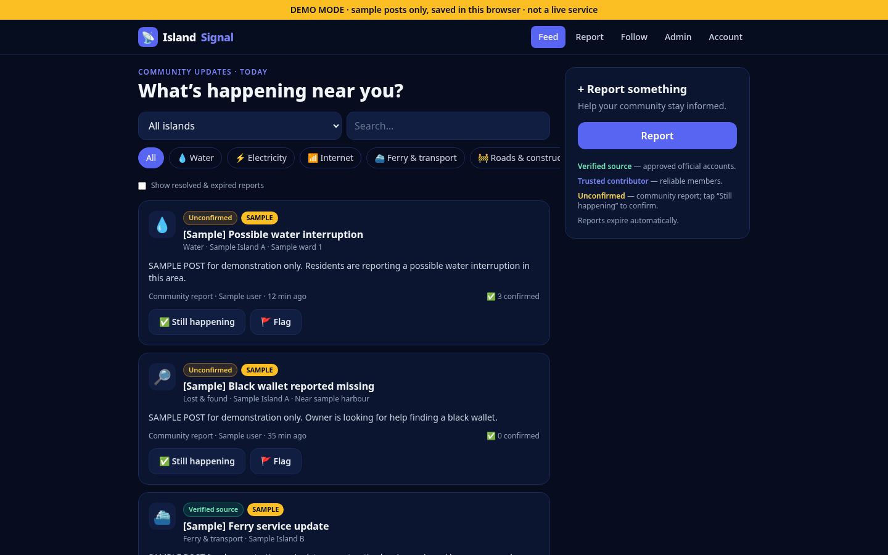
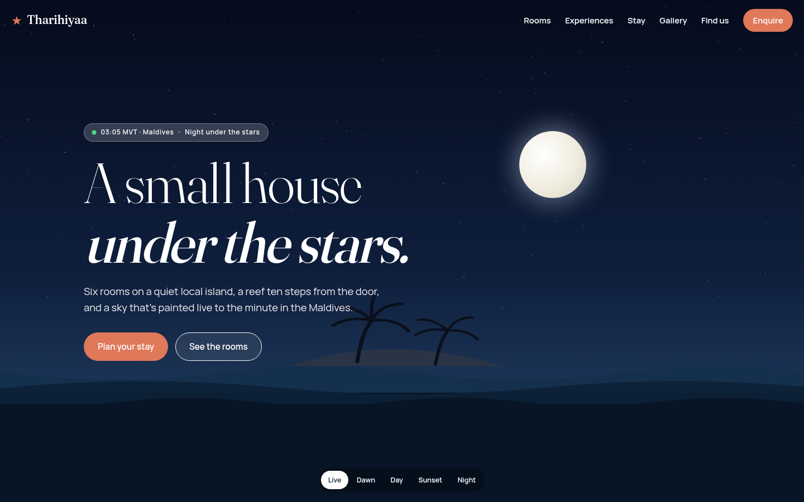

  

  

I'm Fathimath Malaak Jaufar — a maker, developer and researcher from Malé, Maldives. I build small, useful websites and tools, and I'm a lifelong learner who likes turning an idea into something you can open in a browser.

Most of my work is made with HTML, CSS and JavaScript, and hosted on GitHub Pages.

## Skills

  
  
  
  
  
  
  

## GitHub stats

  
  

  

  

## Featured projects

<table>
  <tr>
    <td align="center" valign="top" width="50%">
      <h3><a href="https://reseachrandomv.github.io/news/">Raajjé Digest</a></h3>
      
      
A free Maldives news site that also brings together world news, tech, science, courses and announcements, and updates itself every 30 minutes.

      
<a href="https://reseachrandomv.github.io/news/">Live site</a> · <a href="https://github.com/reseachrandomv/news">Source</a>

    </td>
    <td align="center" valign="top" width="50%">
      <h3><a href="https://reseachrandomv.github.io/solea-cafe/">Youth Hub Café</a></h3>
      
      
A Korean-inspired café website concept set in Malé, with five zones, a menu, and online order and booking flows.

      
<a href="https://reseachrandomv.github.io/solea-cafe/">Live site</a> · <a href="https://github.com/reseachrandomv/solea-cafe">Source</a>

    </td>
  </tr>
  <tr>
    <td align="center" valign="top" width="50%">
      <h3><a href="https://reseachrandomv.github.io/blush-studio/">Blush Studio</a></h3>
      
      
A demo luxury hair and beauty salon website set in Malé, with sample services and a WhatsApp booking flow.

      
<a href="https://reseachrandomv.github.io/blush-studio/">Live site</a> · <a href="https://github.com/reseachrandomv/blush-studio">Source</a>

    </td>
    <td align="center" valign="top" width="50%">
      <h3><a href="https://reseachrandomv.github.io/dhivehi-fonts/">Liyun — free Dhivehi fonts</a></h3>
      
      
A free library of openly licensed Thaana (Dhivehi) fonts, with a live type tester, a Latin-to-Thaana keyboard, and web CSS snippets.

      
<a href="https://reseachrandomv.github.io/dhivehi-fonts/">Live site</a> · <a href="https://github.com/reseachrandomv/dhivehi-fonts">Source</a>

    </td>
  </tr>
  <tr>
    <td align="center" valign="top" width="50%">
      <h3><a href="https://reseachrandomv.github.io/islandsignal/">IslandSignal</a></h3>
      
      
A community-powered, installable PWA for local island updates such as outages, ferry changes, lost and found, and public notices. The public GitHub Pages site runs in demo mode (sample posts, stored in the browser only).

      
<a href="https://reseachrandomv.github.io/islandsignal/">Live demo</a> · <a href="https://github.com/reseachrandomv/islandsignal">Source</a>

    </td>
    <td align="center" valign="top" width="50%">
      <h3><a href="https://reseachrandomv.github.io/guesthouse-demo/">Tharihiyaa — island guesthouse</a></h3>
      
      
A design demo for a fictional Maldivian guesthouse. The hero sky follows live Maldives time (dawn, day, sunset and night).

      
<a href="https://reseachrandomv.github.io/guesthouse-demo/">Live site</a> · <a href="https://github.com/reseachrandomv/guesthouse-demo">Source</a>

    </td>
  </tr>
</table>

## Find me

[GitHub](https://github.com/reseachrandomv)
